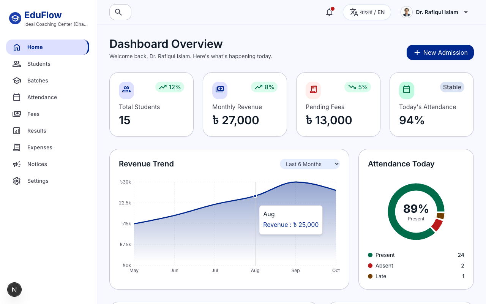
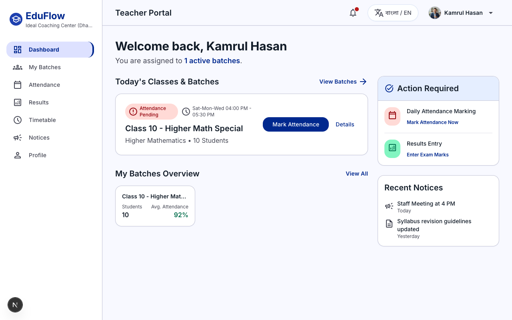
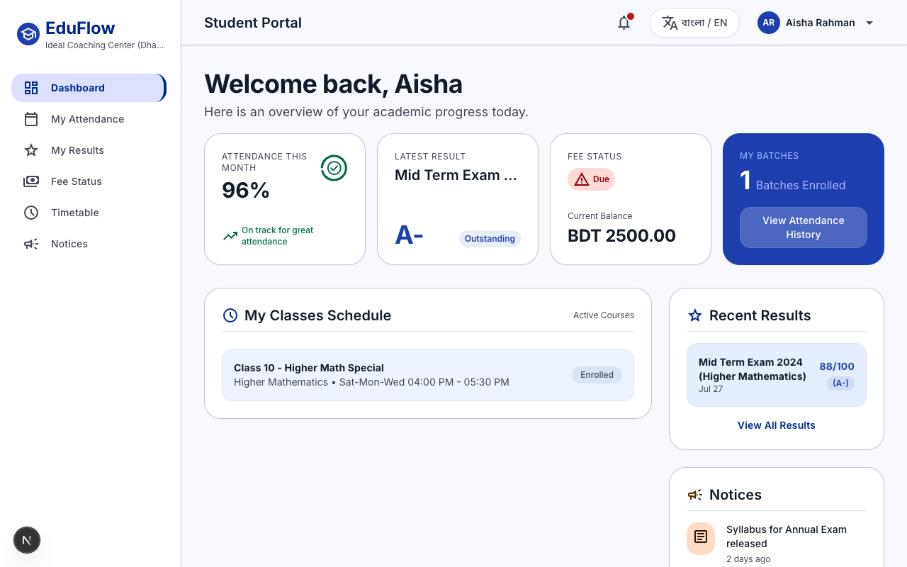
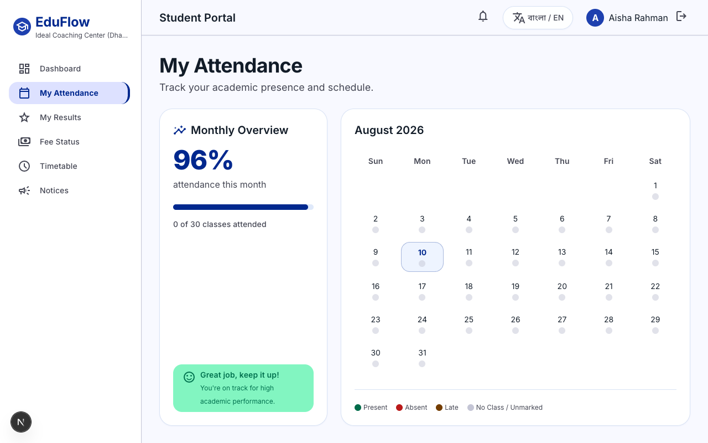
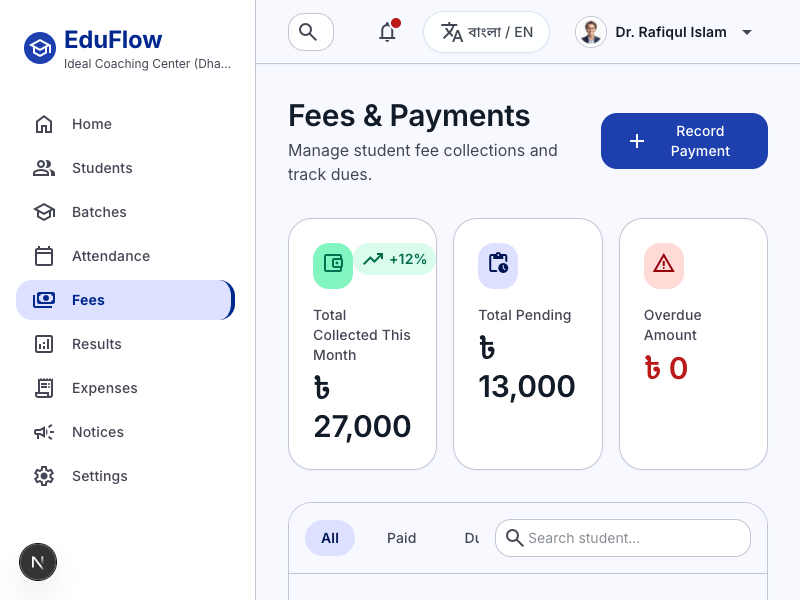
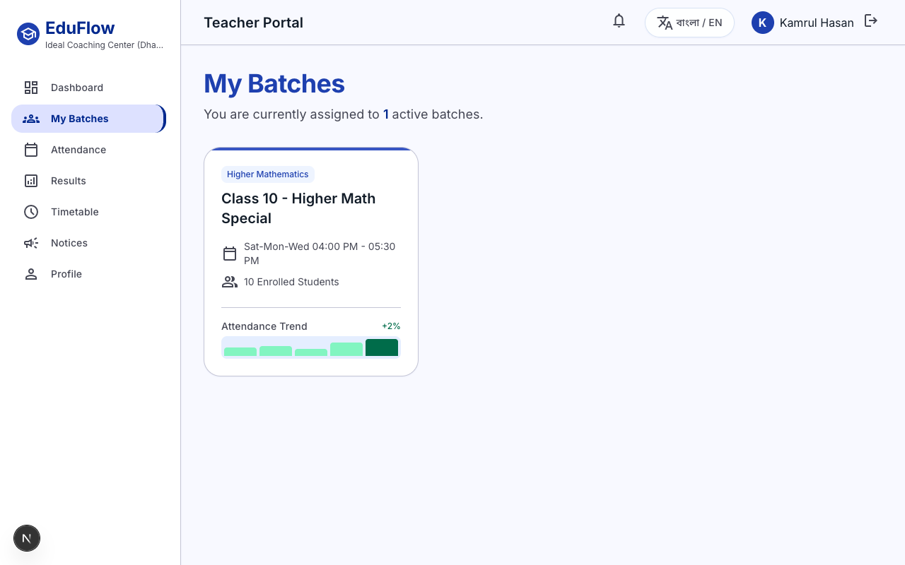
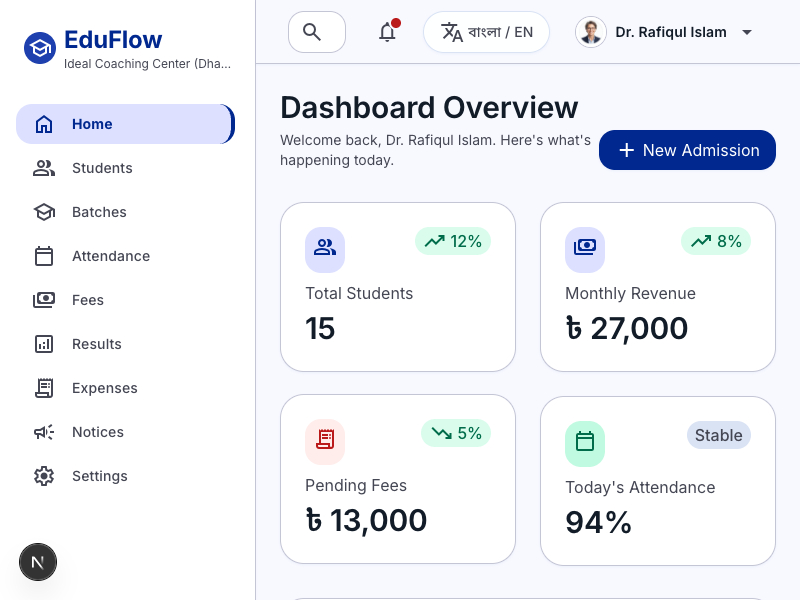
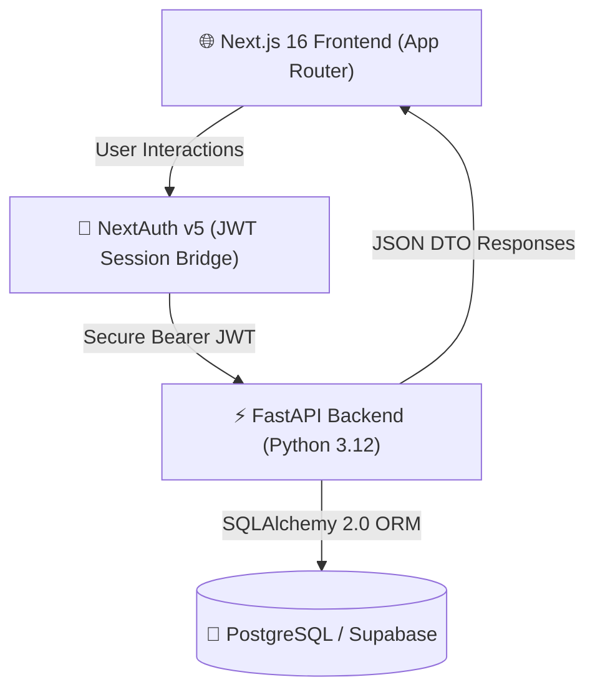

<div align="center">

# 🎓 EduFlow

### Modern, Multi-Tenant Institute & Coaching Management SaaS

[](https://nextjs.org/)
[](https://react.dev/)
[](https://fastapi.tiangolo.com/)
[](https://www.postgresql.org/)
[](https://tailwindcss.com/)
[](https://www.typescriptlang.org/)
[](https://www.docker.com/)

<p align="center">
  <b>EduFlow</b> is a high-performance, full-stack educational management platform engineered for coaching centers, academies, and private schools. Designed with a strict decoupled modern SaaS monorepo architecture featuring <b>Next.js 16</b>, <b>FastAPI</b>, and <b>PostgreSQL</b>.
</p>

[✨ Live Features](#-key-features) • [📸 Screenshots](#-product-showcase) • [🏗️ Architecture](#-system-architecture) • [🚀 Quickstart](#-quickstart-guide) • [☁️ Free Deployment](#-100-free-cloud-deployment)

---

### 🌟 Hero Preview: Multi-Role Experience

| 🏢 Institute Owner Portal | 👨‍🏫 Teacher Portal |
| :---: | :---: |
|  |  |
| **Real-time Analytics, Revenue & Operations** | **Class Batches, Attendance & Exam Marking** |

| 🎓 Student Academic Portal | 📅 Attendance Heatmap & Calendar |
| :---: | :---: |
|  |  |
| **Grades, Fee Invoices & Announcements** | **Visual Monthly Tracking & Status** |

</div>

---

## 📸 Product Showcase

<details open>
<summary><b>💰 Finance & Fee Collection System</b></summary>
<br>

Track institutional income, pending dues, overdue amounts, and record cash or digital receipts on the fly:

| 📋 Real-Time Fee Management | 💳 Record Payment Modal |
| :---: | :---: |
|  |  |
| Automated balance calculations & status badges | Instant receipt generation & transaction history |

</details>

<details open>
<summary><b>👥 Batch Management & Faculty Workflows</b></summary>
<br>

Assign faculty members, organize student groups, and enter examination scores in real-time:

| 📚 Teacher Batches & Group Overview | 🎯 Quick Results Entry & Report Cards |
| :---: | :---: |
|  |  |
| Instant batch schedules & student counts | Fast marks entry matrix & printable report cards |

</details>

---

## ✨ Key Features

- 🏢 **Multi-Tenant Data Isolation**: Complete institute-level isolation across all entities using institutional foreign keys and scoped queries.
- 🔐 **Role-Based Access Control (RBAC)**: Tailored portals for **Owners/Admins**, **Teachers**, and **Students** with Edge middleware authorization.
- 📊 **Dynamic Financial Tracking**: Monitor monthly income, operational expenses, pending student fees, and issue print-ready receipts.
- 📅 **Attendance Engine**: Interactive daily attendance marking with monthly attendance percentages and calendar visualization.
- 📝 **Results & Report Cards**: Automated GPA computation, exam rankings, subject-wise marks entry, and printable student grade sheets.
- 🌐 **Full Bilingual Support**: Built-in localization support for **English** and **Bangla (বাংলা)** with instant language toggling.
- ⚡ **High-Performance Turbopack & FastAPI**: Sub-100ms API response times powered by async FastAPI and Next.js 16 SSR.

---

## 🏗️ System Architecture



---

## 📁 Clean SaaS Repository Layout

```
EduFlow/
├── frontend/             # Next.js 16 (App Router) + React 19 + Tailwind CSS Frontend
│   ├── src/              # Application code (app, components, actions, lib, types)
│   ├── public/           # Static assets, fonts, icons
│   ├── messages/         # i18n translations (en.json, bn.json)
│   ├── Dockerfile        # Production multi-stage container build
│   ├── package.json      # Production dependencies & build scripts
│   └── tsconfig.json
│
├── backend/              # FastAPI + SQLAlchemy 2.0 + PostgreSQL Backend
│   ├── app/              # Domain routers, models, schemas, services, security
│   ├── alembic/          # Database migrations
│   ├── tests/            # Automated test suite
│   ├── Dockerfile        # Production Python 3.12 container build
│   ├── seed.sql          # Full database dump for 1-click cloud import
│   └── requirements.txt  # Pinned Python dependencies
│
├── others/               # Auxiliary resources (Not needed during production build)
│   ├── docs/             # Architecture specifications, PRDs, and conversion reports
│   ├── design/           # Stitch design tokens, screens & marketing graphics
│   ├── scripts/          # QA audit suites, Puppeteer tests & migration tools
│   ├── screenshots/      # High-resolution application screenshots (*.png)
│   └── legacy/           # Historical Prisma schemas & SQLite archive
│
├── docker-compose.yml    # Full-stack container orchestration
├── render.yaml           # 1-Click Render Blueprint configuration
├── package.json          # Monorepo root helper scripts
└── .env.example          # Environment variable template
```

---

## 🚀 Quickstart Guide

### Option 1: Docker (Single Command)
```bash
docker-compose up --build
```
- **Frontend**: [http://localhost:3000](http://localhost:3000)
- **Backend API**: [http://localhost:8000](http://localhost:8000)
- **FastAPI Interactive Docs**: [http://localhost:8000/docs](http://localhost:8000/docs)

---

### Option 2: Local Development

#### 1. Backend Setup (FastAPI)
```bash
cd backend
python3 -m venv venv
source venv/bin/activate
pip install -r requirements.txt
uvicorn app.main:app --reload --host 0.0.0.0 --port 8000
```

#### 2. Frontend Setup (Next.js)
```bash
cd frontend
npm install
npm run dev
```

---

## ☁️ 100% Free Cloud Deployment

| Component | Free Provider | Setup Time |
| :--- | :--- | :--- |
| **Database** | [Supabase](https://supabase.com) (PostgreSQL) | 2 mins |
| **Backend API** | [Render](https://render.com) (FastAPI Web Service) | 3 mins |
| **Frontend** | [Vercel](https://vercel.com) (Next.js) | 2 mins |

1. **Database**: Create a free project on **Supabase**, open the **SQL Editor**, and run the SQL from [`backend/seed.sql`](backend/seed.sql). Copy your database connection URI.
2. **Backend**: Import the repo into **Render** using Blueprint (`render.yaml`), add your Supabase `DATABASE_URL`, and click **Deploy**.
3. **Frontend**: Import the repo into **Vercel**, set root directory to `frontend`, add `NEXT_PUBLIC_API_URL` (your Render backend URL), and click **Deploy**.

---

## 👥 Demo Credentials

| Role | Email | Password | Access Level |
| :--- | :--- | :--- | :--- |
| **Owner / Admin** | `owner@eduflow.bd` | `password123` | Full institute administration, financials & analytics |
| **Teacher** | `kamrul@eduflow.bd` | `password123` | Assigned batches, attendance marking & results |
| **Student** | `student1@eduflow.bd` | `password123` | Academic performance, attendance calendar & fee status |

---

<div align="center">

Built with ❤️ for modern educators and institutes worldwide.

</div>
